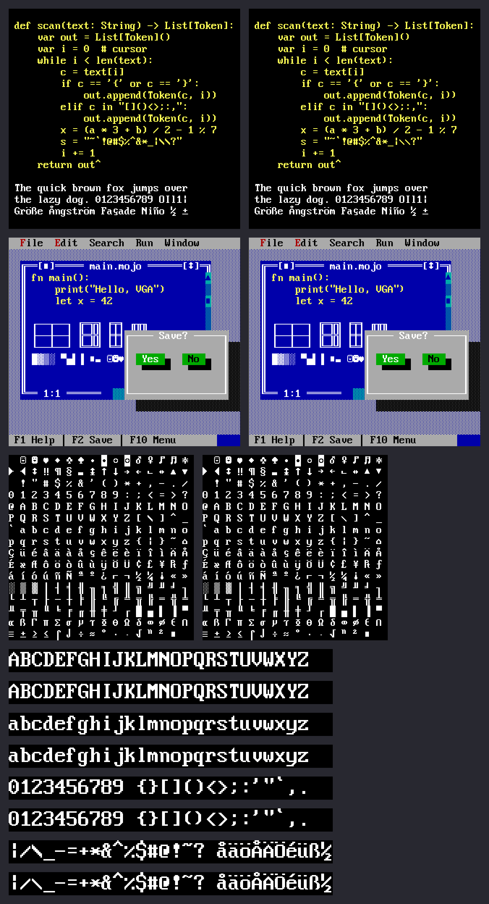

# TurboKod VGA 16x32

A 16×32 pixel redraw of the IBM VGA 8×16 text-mode font (VileR's
[Px437 IBM VGA 8x16](https://int10h.org/oldschool-pc-fonts/)), made for
[TurboKod](https://github.com/boxed/TurboKod). It keeps the shapes and
feel of the original but uses the doubled resolution for clean 45°
diagonals, sharp points and rounder bowls, while staying pure pixel art:
every outline is a union of whole pixel squares.

The TTF also embeds the original 8×16 bitmaps as a 16px bitmap strike, so
renderers that honor embedded bitmaps (macOS Core Text, FreeType, Windows)
draw the exact original font when a cell is 16 device pixels tall, and the
16×32 design on Retina screens and at 32px and up.



## Layout

- `glyphs/vga8x16.txt`: the reference glyphs, extracted from `reference/Px437_IBM_VGA_8x16.ttf`.
- `glyphs/font16x32.txt`: the automatic 2× seed (regenerated by `tools/seed.py`).
- `glyphs/hand16x32.txt`: hand-drawn glyphs, which override the seed.
- `glyphs/powerline16x32.txt`, `glyphs/powerline8x16.txt`: Powerline icons (U+E0A0–E0A2) at both sizes; the separators (U+E0B0–E0B3, plus the Nerd Fonts half circles and slants U+E0B4–E0BF) are generated by `tools/powerline.py`.
- `tools/`: extraction, smoothing, preview, TTF build and the Core Text strike test.

Glyphs are plain text, `.` for off and `#` for on, one `glyph NAME U+XXXX`
header per glyph. Box drawing, block and shade characters are scaled
exactly 2× from the reference so they keep tiling.

## Usage

```sh
uv venv .venv && uv pip install --python .venv/bin/python fonttools pillow

.venv/bin/python tools/seed.py                  # regenerate the automatic seed
.venv/bin/python tools/replace.py patch.txt     # add/replace hand-drawn glyphs
.venv/bin/python tools/preview.py               # out/preview.png
.venv/bin/python tools/sample.py "text" 3       # out/sample.png
.venv/bin/python tools/build_ttf.py out/TurboKodVGA16x32.ttf
PYTHONPATH=tools .venv/bin/python tools/strike_test.py   # macOS: check the 16px strike
```

## License

The font is a derivative of Px437 IBM VGA 8x16 from the Oldschool PC Font
Resource by VileR (https://int10h.org/oldschool-pc-fonts/), and like it is
licensed under [CC BY-SA 4.0](LICENSE).
